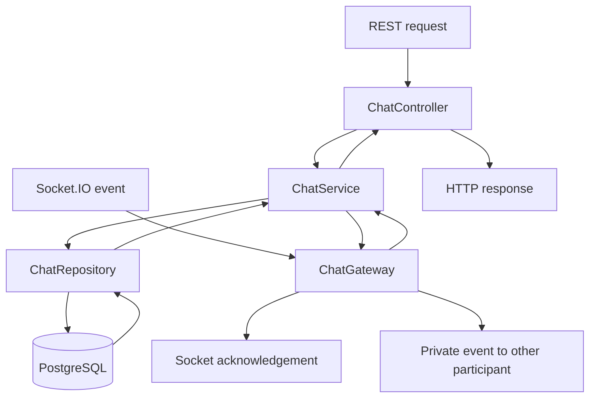

# Chat module study guide

This guide explains the code currently in this repository: which file to open, what each function does, who calls it, and where its result goes. Read [CHAT.md](CHAT.md) for API/event payload examples and [CHAT_PHASE4_REVIEW.md](CHAT_PHASE4_REVIEW.md) for the final review and test results.

Message deletion is documented in [CHAT_MESSAGE_DELETION.md](CHAT_MESSAGE_DELETION.md), including its required migration.

## 1. Start with the overall flow

The chat backend has two entry points:

| Entry point      | Used for                                                             | First file           |
| ---------------- | -------------------------------------------------------------------- | -------------------- |
| REST requests    | Find/create a conversation, list conversations, load message history | `chat.controller.ts` |
| Socket.IO events | Send/delete messages, mark messages read, start/stop typing          | `chat.gateway.ts`    |

Both call the same service and repository:



For example, Alice sends a message to Bob. The gateway receives the event, the service calls the repository, and the repository saves the message. After the transaction commits, the gateway sends Bob a private event and returns an acknowledgement to Alice.

**A saved message and a delivered event are different things.** PostgreSQL preserves the message. Socket.IO delivers a live notification when a recipient is connected; history recovers messages missed while offline.

## 2. Where each file belongs

Paths in this tree start at the repository root:

```text
src/chat/
├── chat.module.ts                         Registers the feature
├── chat.controller.ts                     REST endpoints
├── chat.service.ts                        Entry points into repository operations
├── chat.repository.ts                     Database queries, membership, response mapping
├── chat.gateway.ts                        Socket connections and live events
├── entities/
│   ├── conversation.entity.ts              Maps a conversation to PostgreSQL
│   └── message.entity.ts                   Maps a message to PostgreSQL
├── dto/
│   ├── create-conversation.dto.ts          Validates a recipient ID
│   ├── list-conversations-query.dto.ts     Validates conversation pagination
│   ├── list-messages-query.dto.ts          Validates history pagination
│   ├── delete-message.dto.ts               Validates the message ID to delete
│   ├── send-message.dto.ts                 Validates a message-send payload
│   ├── conversation-event.dto.ts           Validates read/typing payloads
│   ├── conversation-response.dto.ts        Documents one conversation and its other user
│   ├── conversation-page-response.dto.ts   Documents a conversation page
│   ├── message-response.dto.ts             Documents one message
│   └── message-page-response.dto.ts         Documents a message page
├── interface/
│   ├── chat-ack.interface.ts               TypeScript acknowledgement/error types
│   └── chat-event.interface.ts             TypeScript event/result types
├── chat.message-deletion.spec.ts           Deletion gateway unit tests
└── chat.postgres.spec.ts                   PostgreSQL, REST, and real socket tests

src/database/migrations/
└── 1792584000000-AddPrivateChat.ts          Creates the chat tables and integrity rules

test/
└── app.e2e-spec.ts                         Tests the complete application together
```

The current folder is named **`interface`**, singular. Use that spelling in imports.

## 3. `chat.module.ts`: how NestJS connects the files

Open [chat.module.ts](../src/chat/chat.module.ts).

`ChatModule` has no request-handling functions. Its `@Module()` decorator tells Nest which pieces belong together:

| Setting       | What it registers                                               | Why                                                              |
| ------------- | --------------------------------------------------------------- | ---------------------------------------------------------------- |
| `imports`     | `AuthModule`                                                    | Makes existing authentication services/guards available          |
| `imports`     | `TypeOrmModule.forFeature([ConversationEntity, MessageEntity])` | Makes the entity repositories available in this feature          |
| `controllers` | `ChatController`                                                | Activates the REST routes                                        |
| `providers`   | `ChatRepository`, `ChatService`, `ChatGateway`                  | Lets Nest create and inject these classes; activates the gateway |

[AppModule](../src/app.module.ts) imports `ChatModule`, making the feature part of the running application.

`@Inject(...)` asks Nest to supply a dependency. You do not manually create `new ChatService()` inside the controller or gateway. `@InjectRepository(ConversationEntity)` supplies TypeORM's repository for the conversation entity.

Registering the entities does not create their tables. They use `synchronize: false`; the migration creates the chat schema.

## 4. `chat.controller.ts`: the three REST endpoints

Open [chat.controller.ts](../src/chat/chat.controller.ts).

`@Controller('chat')` supplies the route prefix. The application's global prefix is `/api/v1`, so these routes begin with `/api/v1/chat`.

`@UseGuards(JwtAuthGuard)` protects the whole controller. The guard verifies the Bearer access token and puts the authenticated account in `request.user`. `@ApiBearerAuth()` documents that requirement in Swagger; the guard performs the actual authentication.

### `constructor()`

Receives `ChatService` from NestJS. The controller uses it for all three operations.

### `findOrCreate(dto, request)`

- **Triggered by:** `POST /api/v1/chat/conversations`.
- **Receives:** a validated `CreateConversationDto` containing `recipientId`.
- **Calls:** `chatService.findOrCreate(request.user.id, dto)`.
- **Returns:** a formatted conversation, whether newly created or already existing.

The sender comes from `request.user.id`, never from the body. `@HttpCode(HttpStatus.OK)` makes both outcomes return HTTP 200.

### `findMine(query, request)`

- **Triggered by:** `GET /api/v1/chat/conversations`.
- **Receives:** validated `page` and `limit` query parameters.
- **Calls:** `chatService.findMine(request.user.id, query)`.
- **Returns:** a page containing only conversations this user belongs to.

### `findMessages(id, query, request)`

- **Triggered by:** `GET /api/v1/chat/conversations/:id/messages`.
- **Receives:** the conversation UUID and validated pagination.
- **Calls:** `chatService.findMessages(id, request.user.id, query)`.
- **Returns:** a page of messages after the repository checks membership.

`ParseUUIDPipe` rejects an invalid path ID. `dtoValidationPipe(...)` validates bodies/query objects and rejects unexpected properties.

## 5. `chat.service.ts`: the small middle layer

Open [chat.service.ts](../src/chat/chat.service.ts).

The service keeps a consistent entry point for controllers and the gateway. Most functions delegate directly because the repository already owns this project's database operations and membership checks.

| Function                              | Called by                | What it does                                                                                                  |
| ------------------------------------- | ------------------------ | ------------------------------------------------------------------------------------------------------------- |
| `constructor()`                       | NestJS                   | Receives `ChatRepository`.                                                                                    |
| `findOrCreate(userId, dto)`           | Controller               | Finds/creates the entity, then calls the repository's `toResponse()` to return the public conversation shape. |
| `findMine(userId, query)`             | Controller               | Delegates paginated conversation listing.                                                                     |
| `findMessages(id, userId, query)`     | Controller               | Delegates authorized history retrieval.                                                                       |
| `saveMessage(userId, dto)`            | Gateway `sendMessage()`  | Delegates transactional, retry-safe message saving.                                                           |
| `markMessagesRead(userId, dto)`       | Gateway `readMessages()` | Delegates updates to messages received by this user.                                                          |
| `findForUser(conversationId, userId)` | Gateway `typing()`       | Retrieves a conversation only after membership is checked.                                                    |

Functions with the same name in different classes are separate functions. For example, controller `findMine()` calls service `findMine()`, which calls repository `findMine()`.

## 6. `chat.repository.ts`: database operations

Open [chat.repository.ts](../src/chat/chat.repository.ts).

### `constructor()`

Receives `Repository<ConversationEntity>`. `this.conversations` queries the conversation table. Its `manager` can obtain the existing User and Message repositories or start a transaction.

### `findOrCreate(userId, input)`

**Purpose:** allow one conversation per pair of users.

1. Validate `CreateConversationDto` again at the operation boundary.
2. Lowercase the sender and recipient UUIDs.
3. Reject the same user as both participants with 400.
4. Check that the recipient exists; otherwise return 404.
5. Sort the pair into `user1Id` and `user2Id`.
6. Return an existing conversation if found.
7. Otherwise create and save a conversation entity.
8. If another request inserted the same pair first, handle the named PostgreSQL unique violation and retrieve that conversation.

Sorting means Alice/Bob and Bob/Alice refer to the same pair. **`user1Id` does not mean the sender or conversation owner.** Either participant may send messages.

The early lookup is convenient, but the database unique index is what makes simultaneous requests safe. Other database failures are rethrown rather than treated as duplicates.

### `findForUser(id, userId)`

**Purpose:** fetch a conversation and authorize access.

It looks up the conversation by ID, returns 404 when missing, and calls `assertParticipant()` before returning the entity. History and typing use this method. Transactional send/read operations load the conversation through their transaction manager and call `assertParticipant()` there instead.

### `findMessages(id, userId, input)`

**Purpose:** return private, paginated history.

It first calls `findForUser()`, validates pagination, and retrieves messages for that conversation. Ordering is `createdAt DESC, id DESC`: newest first, with an ID tie-breaker when timestamps match. It maps entities using `messageResponse()` and returns:

```text
{ items, page, limit, total, totalPages }
```

`skip = (page - 1) * limit` chooses the offset; `take = limit` bounds the page. Reading history does not change `isRead`.

### `toResponse(conversation, userId)`

**Purpose:** format one conversation.

It calls `toResponses([conversation], userId)` and returns the first result. The service calls this after find/create so the API returns safe user information and message summary fields rather than an entity with participant IDs alone.

### `findMine(userId, input)`

**Purpose:** return this user's conversation list.

The two entries in `where` mean `user1Id matches OR user2Id matches`. It orders by `updatedAt DESC, id DESC`, applies pagination, then calls `toResponses()` for the selected page. It returns page metadata and the formatted items.

A new message updates conversation `updatedAt`. Reading or typing does not move the conversation to the top.

### `assertParticipant(conversation, userId)` — private

**Purpose:** enforce that the caller is one of the two participants.

It compares the normalized user ID to `user1Id` and `user2Id`, throwing 403 if neither matches. There is no admin bypass. A private method is an internal helper; privacy is enforced by these checks, not by the TypeScript `private` keyword.

### `toResponses(conversations, userId)` — private

**Purpose:** enrich a whole conversation page without querying each item separately.

It returns an empty array for an empty page and checks membership for every conversation. It then makes three batch queries:

1. Load the other participants, selecting only `id` and `displayName`.
2. Use PostgreSQL `DISTINCT ON` to select the latest message for each conversation, ordered by message time and ID.
3. Group unread messages by conversation, excluding messages sent by the current user.

It builds `Map` objects to look up users, latest messages, and counts by ID. Finally it assembles each `ConversationResponseDto`:

```text
{ id, otherUser, lastMessage, unreadCount, createdAt, updatedAt }
```

`lastMessage` is null if no message exists. Its `createdAt` is the last-message timestamp. `unreadCount` counts received unread messages, not the current user's own outgoing messages.

### `messageResponse(message)` — private

**Purpose:** explicitly choose fields returned for a message.

It copies `id`, `conversationId`, `senderId`, `clientMessageId`, `content`, `deletedAt`, `isRead`, and `createdAt`. Both history and live sending use this shape. It does not include the sender's user entity or credentials.

### `saveMessage(userId, input)`

**Purpose:** save a new message or return an identical retry.

This is called by service `saveMessage()`, which is called by gateway `sendMessage()`.

1. Validate the send DTO and normalize UUIDs.
2. Start a database transaction.
3. Load the conversation using that transaction's manager and acquire a `pessimistic_write` row lock.
4. Reject a missing conversation or an outsider.
5. Attempt insertion using `.orIgnore().returning('id')`.
6. Determine whether an insert happened from the returned rows.
7. Retrieve the message using `senderId` plus `clientMessageId`.
8. If the stored conversation/content differs, throw 409: the retry ID was reused for another message.
9. For a new insert only, update the conversation timestamp in the same transaction.
10. Return `{ message, recipientId, created }` after the transaction commits.

`created: true` means a new message row; `created: false` means an existing identical retry. The gateway emits `message:new` only when `created` is true. Retrying a deleted message is rejected with CONFLICT, so its text cannot be restored.

`.orIgnore()` becomes PostgreSQL conflict-ignore behavior. The sender/client-ID unique index prevents retry duplicates. The subsequent lookup and content/conversation comparison ensure an ignored insert is accepted only as a matching retry. Foreign-key and other non-unique failures are not turned into successful retries.

The row lock coordinates send/read operations on this conversation until commit or rollback. It does not lock every conversation. If insertion succeeds but updating `updatedAt` fails, the transaction rolls back the insertion too. Use `manager`, not a separate repository connection, for writes that must belong to that transaction.

`recipientId` is internal routing information. It identifies the other participant; the gateway leaves it out of the acknowledgement sent to the client.

### `markMessagesRead(userId, input)`

**Purpose:** mark messages received by the authenticated user as read.

It validates the conversation-event DTO, starts a transaction, locks the conversation, and verifies membership. The update matches all three conditions:

```text
conversationId = selected conversation
senderId != authenticated reader
isRead = false
deletedAt IS NULL
```

It sets those rows to `isRead: true` and returns `{ conversationId, readerId, recipientId, updated }`. `updated` is the affected-row count; repeating a read returns zero once nothing remains unread.

If Bob reads the conversation, Alice's unread messages change. Bob's own messages stay unread until Alice reads them. There is no read timestamp column: the current schema stores only a boolean.

## 7. `chat.gateway.ts`: connections and live events

Open [chat.gateway.ts](../src/chat/chat.gateway.ts).

### Gateway configuration and stored state

| Code                           | Meaning                                                                                                 |
| ------------------------------ | ------------------------------------------------------------------------------------------------------- |
| `namespace: '/chat'`           | Clients connect to `http://localhost:5300/chat` using Socket.IO.                                        |
| `transports: ['websocket']`    | Uses the WebSocket transport; no polling fallback. Socket.IO still has its own protocol.                |
| `maxHttpBufferSize: 16 * 1024` | Limits an incoming Socket.IO packet to 16 KiB.                                                          |
| `cors`                         | Uses `frontendOrigins()` for allowed origins. The handshake middleware checks Origin too.               |
| `server: Namespace`            | The server-side Socket.IO `/chat` namespace, used to find sockets/rooms and deliver events.             |
| `ChatSocketData`               | Server-side `userId`, `accessToken`, and expiry time in milliseconds.                                   |
| `ChatSocket`                   | Socket.IO socket type whose `data` follows `ChatSocketData`; it does not create a connection by itself. |
| `authTimers`                   | Maps each socket ID to its periodic session-check timer and expiry timer.                               |
| `rateLimits`                   | Maps each authenticated user ID to counters and a reset deadline, shared across that user's sockets.    |
| `rateCleanup`                  | Timer that removes expired rate-limit entries.                                                          |

`constructor()` receives the existing `AuthService` and this feature's `ChatService` through Nest dependency injection.

### `afterInit(server)`

**Called by Nest when the gateway initializes.**

It starts rate-limit cleanup and installs namespace connection middleware with `server.use(...)`. For each attempted connection, that middleware:

1. Rejects a supplied Origin outside the configured frontend origins.
2. Reads `socket.handshake.auth.accessToken`; rejects missing/non-string tokens.
3. Calls existing `AuthService.authenticate()` to verify the JWT, session, and active account.
4. Decodes the already-verified JWT payload to obtain `exp`.
5. Converts expiry seconds to milliseconds and stores verified identity/token/expiry in `socket.data`.
6. Calls `next()` to accept the connection, or `next(new Error(...))` to reject it.

**Base64 decoding is not signature verification.** The code reads `exp` only after AuthService verifies that exact token. Clients cannot authenticate by sending a plain email or user ID.

`socket.data` is stored on the server; these fields are not automatically sent to the browser. A client without an Origin header still needs a valid token. Connection failures become Socket.IO `connect_error`, not an HTTP-controller response or event acknowledgement.

### `handleConnection(socket)`

**Called by Nest after the connection middleware accepts a socket.**

It rejects an already-expired token, joins the server-controlled room `user:<userId>`, and starts two timers:

- A repeating check every 30 seconds for session revocation/account status.
- A timeout scheduled for the token's expiry deadline.

The local `checking` flag prevents overlapping periodic checks if a database query is slow. `.unref()` lets Node exit when only these timers remain; it does not cancel them.

A room groups all connections belonging to one user. Bob's laptop and phone have different socket IDs but both join `user:<Bob's ID>`. The client cannot choose somebody else's room through a chat event.

### `handleDisconnect(socket)`

**Called by Nest when a socket disconnects.**

It clears that socket's two authentication timers and removes its map entry. It leaves the user's rate-limit bucket until its normal expiry, so reconnecting does not reset the quota. Socket.IO automatically removes the socket from rooms.

### `onModuleDestroy()`

**Called by Nest during application shutdown.**

It clears all remaining authentication timers, the rate-cleanup interval, and in-memory maps. It does not delete conversations or messages from PostgreSQL.

### `sendMessage(socket, input)`

**Triggered by `@SubscribeMessage('message:send')`.**

It applies the send/event quota, reauthenticates the socket, validates `SendMessageDto`, and calls `chatService.saveMessage()`. After a new message commits, it calls `emitToUser()` for the recipient. For an existing identical retry, it skips emission.

It returns `ChatAck<MessageSent>`: `{ ok: true, data: { message, created } }` or a safe error from `errorAck()`. Nest's Socket.IO adapter sends the returned value through the client's acknowledgement callback when one is supplied.

`@ConnectedSocket()` supplies the verified connection object. `@MessageBody()` supplies the event payload; it is `unknown` until validated.

### `readMessages(socket, input)`

**Triggered by `message:read`.**

It applies the event quota, reauthenticates, validates `ConversationEventDto`, and calls `chatService.markMessagesRead()`. It returns a receipt containing `conversationId`, `readerId`, and `updated`. If `updated > 0`, it also emits that receipt to the other participant.

It removes internal `recipientId` from the client-facing receipt. A receipt signals that read state changed; clients should refresh canonical message flags rather than blindly marking later-arriving messages read from a count alone.

### `deleteMessage(socket, input)`

**Triggered by `message:delete`.** It checks the event quota and credentials, validates `DeleteMessageDto`, and calls service `deleteMessage()`. The service delegates to repository `deleteMessage(userId, input)`, which locks the conversation, checks membership and message ownership, then sets `content: null` and the first deletion time. The row and its original sender/creation time stay in history.

The repository returns an internal `changed` flag and recipient ID. The gateway sends `{ messageId, conversationId, deletedAt }` to both participants' authorized connections only when changed, and returns those same public fields in the acknowledgement. Repeating deletion succeeds without another notification. Admins can delete only their own sent messages.

### `typingStart(socket, input)`

**Triggered by `typing:start`.** Delegates to private `typing(socket, input, 'typing:start')`.

### `typingStop(socket, input)`

**Triggered by `typing:stop`.** Delegates to private `typing(socket, input, 'typing:stop')`.

### `typing(socket, input, event)` — private

**Purpose:** share the same authorization and routing logic between the two typing events.

It checks the event quota, reauthenticates, validates the conversation ID, and calls service `findForUser()` to verify membership. It finds the other participant and emits `{ conversationId, userId }`, deriving `userId` from authentication.

It returns the same data in an acknowledgement. It stores no typing rows or flags in PostgreSQL. The backend sends events; the future frontend decides how to display/clear the typing indicator.

### `authenticateSocket(socket)` — private

**Purpose:** ensure this connection can still act or receive private events.

It checks connection status/expiry, calls existing AuthService again, and checks connection status/expiry again after that asynchronous operation. It also checks that the authenticated user matches the identity saved on the socket. It returns the verified user ID.

The second check matters because the token can expire or the client can disconnect while the database queries are pending. Failure disconnects the socket and throws `UnauthorizedException`. An acknowledgement might not reach a socket already being disconnected, so clients must handle disconnections/timeouts too.

This function is used by incoming events, periodic checks, and private recipient delivery.

### `emitToUser(userId, notification)` — private

**Purpose:** deliver an event to currently authorized connections of the intended recipient.

It looks up socket IDs in `user:<userId>`, obtains each socket, and calls `authenticateSocket()` for each. It emits the event only to still-connected valid recipients. One revoked tab is disconnected without preventing another valid tab from receiving the event.

If no recipient is online, it returns without a live emission. The saved message remains available through history. It does not broadcast to every socket or create another database message.

### `checkRateLimit(userId, sending = false)` — private

**Purpose:** enforce one-minute, per-user chat quotas.

It creates/resets a bucket when needed, checks the counters, and throws `ThrottlerException` when the quota is exhausted. Otherwise it increments the event count and, for send attempts, the message count.

Constants currently allow **30 send attempts and 120 total event attempts per 60 seconds**. Send attempts count toward both quotas. Malformed/retried attempts that reach the handler consume quota too. A request already rejected at the quota check does not proceed to authentication/database work.

These counters are in process memory. Reconnecting does not reset them; a server restart does. Multiple backend processes would need shared limiting/delivery infrastructure, which is outside this version.

### `objectPayload(input)` — private

**Purpose:** reject `null`, arrays, strings, and other non-object payloads before DTO validation.

It returns the object for `validateDto()` or throws 400. It does not validate individual fields; DTO decorators do that.

### `errorAck(error)` — private

**Purpose:** convert thrown errors into the shared socket error response.

Known HTTP exception statuses map to `BAD_REQUEST`, `UNAUTHORIZED`, `FORBIDDEN`, `NOT_FOUND`, `CONFLICT`, or `RATE_LIMITED`. Validation messages can be joined with semicolons. Unexpected/server errors become `INTERNAL_ERROR` with a generic message, keeping database details out of the response.

`ChatAck<never>` describes a result whose successful data value cannot exist: this helper is used to return errors.

## 8. DTO files: input validation versus response documentation

Request DTOs are classes with validation decorators. Response DTOs describe output fields and Swagger schemas; they do not automatically fetch data, remove fields, or transform an entity into a safe response. The repository's mapping functions do that work.

| File / class                                                                                                           | What it contains                                                                                             | Where it is used                                           |
| ---------------------------------------------------------------------------------------------------------------------- | ------------------------------------------------------------------------------------------------------------ | ---------------------------------------------------------- |
| [create-conversation.dto.ts](../src/chat/dto/create-conversation.dto.ts) / `CreateConversationDto`                     | Required UUID `recipientId`                                                                                  | Controller body and repository find/create validation      |
| [list-conversations-query.dto.ts](../src/chat/dto/list-conversations-query.dto.ts) / `ListConversationsQueryDto`       | Numeric page/limit; defaults 1/20, page max 1,000,000, limit max 50                                          | Controller query and repository list validation            |
| [list-messages-query.dto.ts](../src/chat/dto/list-messages-query.dto.ts) / `ListMessagesQueryDto`                      | Same bounds for history pagination                                                                           | Controller query and repository history validation         |
| [send-message.dto.ts](../src/chat/dto/send-message.dto.ts) / `SendMessageDto`                                          | UUID conversation/retry IDs; string content, nonblank, at most 2,000 characters                              | Gateway send validation and repository message saving      |
| [conversation-event.dto.ts](../src/chat/dto/conversation-event.dto.ts) / `ConversationEventDto`                        | Required UUID `conversationId`                                                                               | Gateway read/typing validation and repository read updates |
| [conversation-response.dto.ts](../src/chat/dto/conversation-response.dto.ts)                                           | `ChatUserDto`: public ID/name. `ConversationResponseDto`: other user, last message, unread count, timestamps | Swagger REST responses and TypeScript return shapes        |
| [conversation-page-response.dto.ts](../src/chat/dto/conversation-page-response.dto.ts) / `ConversationPageResponseDto` | Conversation items plus pagination totals                                                                    | Conversation list response schema/type                     |
| [message-response.dto.ts](../src/chat/dto/message-response.dto.ts) / `MessageResponseDto`                              | Safe message fields                                                                                          | History/send mapping, response documentation, event types  |
| [message-page-response.dto.ts](../src/chat/dto/message-page-response.dto.ts) / `MessagePageResponseDto`                | Message items plus pagination totals                                                                         | History response schema/type                               |

Common decorators:

| Decorator                                   | What it does                                                           |
| ------------------------------------------- | ---------------------------------------------------------------------- |
| `@ApiProperty()` / `@ApiPropertyOptional()` | Describe fields in Swagger; do not perform runtime validation.         |
| `@IsUUID()`                                 | Requires a UUID value.                                                 |
| `@IsString()`                               | Requires a string.                                                     |
| `@Matches(/\S/u)`                           | Requires at least one non-whitespace character.                        |
| `@MaxLength(2000)`                          | Rejects content exceeding the configured character limit.              |
| `@Type(() => Number)`                       | Converts query values such as `"20"` to numbers during transformation. |
| `@IsInt()`, `@Min()`, `@Max()`              | Require integers inside the allowed bounds.                            |

A response `Date` is a JavaScript Date inside the backend and becomes a date-time string when serialized to JSON.

## 9. Interface files: compile-time response shapes

These TypeScript types disappear at runtime. They do not validate socket data or create tables.

Open [chat-ack.interface.ts](../src/chat/interface/chat-ack.interface.ts):

- `ChatErrorCode`: the allowed error-code strings.
- `ChatAck<T>`: either `{ ok: true, data: T }` or `{ ok: false, error: { code, message } }`.
- `T` is the successful data type, such as `MessageSent` or `ReadReceipt`. Check `ack.ok` before reading the corresponding branch.

`chat-event.interface.ts` also defines `MessageDeleted` (`messageId`, `conversationId`, `deletedAt`) for deletion acknowledgements/notifications.

Open [chat-event.interface.ts](../src/chat/interface/chat-event.interface.ts):

| Type             | Fields / purpose                                                                                            |
| ---------------- | ----------------------------------------------------------------------------------------------------------- |
| `MessageSent`    | `message`, `created`: send acknowledgement data.                                                            |
| `MessageDeleted` | `messageId`, `conversationId`, `deletedAt`: deletion acknowledgement and notification to both participants. |
| `ReadReceipt`    | `conversationId`, `readerId`, `updated`: read acknowledgement and recipient notification.                   |
| `TypingEvent`    | `conversationId`, `userId`: typing acknowledgement/notification.                                            |
| `ChatEvent`      | A union connecting supported outgoing event names to their data shapes; used by `emitToUser()`.             |

An acknowledgement replies to the initiating event. A recipient notification is a separate event sent to another socket. Returning success to Alice does not mean Bob has read or even received the live event.

## 10. Entity files: the database model

### `conversation.entity.ts`

Open [ConversationEntity](../src/chat/entities/conversation.entity.ts). It maps to `chat_conversations`.

| Field                    | Meaning                                        |
| ------------------------ | ---------------------------------------------- |
| `id`                     | UUID identifying the conversation.             |
| `user1Id`, `user2Id`     | The two participants in canonical order.       |
| `user1`, `user2`         | TypeORM relations to the existing User entity. |
| `messages`               | One-to-many relation to MessageEntity.         |
| `createdAt`, `updatedAt` | Creation and latest conversation update times. |

**`normalizeParticipants()`** runs through `@BeforeInsert()` when saving a created entity. It lowercases/sorts the two UUIDs. The repository also sorts before looking up the pair; that lookup happens before the insert hook, so both places serve a purpose. Raw SQL/bulk writes must supply the canonical order themselves.

The database requires `user1_id < user2_id` and a unique pair. Equal IDs fail, preventing self-conversations. A user can belong to many conversations. Deleting a user referenced here is restricted; changing participants after creation is blocked by a migration trigger.

### `message.entity.ts`

Open [MessageEntity](../src/chat/entities/message.entity.ts). It maps to `chat_messages`; it declares fields/relations and has no custom methods.

| Field                            | Meaning                                                                                     |
| -------------------------------- | ------------------------------------------------------------------------------------------- |
| `id`                             | UUID identifying the saved message.                                                         |
| `conversationId`, `conversation` | Its parent conversation ID and TypeORM relation.                                            |
| `senderId`, `sender`             | Its authenticated author ID and User relation.                                              |
| `clientMessageId`                | Client-generated retry ID, unique together with the sender.                                 |
| `content`                        | Nonblank live text in varchar(2000), or null after deletion.                                |
| `deletedAt`                      | First deletion time, or null for a live message; a plain column keeps placeholders visible. |
| `isRead`                         | Whether the other participant has marked this message read; defaults false.                 |
| `createdAt`                      | Time the message was created.                                                               |

One conversation has many messages. Deleting a conversation cascades to its messages at the database level; there is currently no chat deletion endpoint. Deleting a referenced sender is restricted.

The `(senderId, clientMessageId)` uniqueness applies across conversations. Alice cannot reuse a retry ID for a different conversation. Bob may independently use that same UUID because his sender ID differs.

`Relation<T>` describes a TypeORM relation at the TypeScript level. Declaring a relation does not automatically load it on every query.

## 11. Migration: creating the tables and database rules

Open [1792584000000-AddPrivateChat.ts](../src/database/migrations/1792584000000-AddPrivateChat.ts).

### `up(queryRunner)`

Creates the chat tables, foreign keys, checks, indexes, and trigger functions. The important indexes protect unique user pairs and sender/retry IDs, and support conversation listing, message history, and unread lookups.

Two PostgreSQL functions live inside SQL strings in this TypeScript method:

- **`chat_check_message_sender()`**: triggered before message insertion or sender/conversation changes. An existing user must also be one of that conversation's participants. A normal user foreign key alone cannot prove membership.
- **`chat_keep_participants()`**: triggered before participant changes. Rejects replacing either user so existing private history cannot be reassigned.

The function that checks membership refers to the migration's schema explicitly. This also makes it work in the disposable schemas used by tests.

### `down(queryRunner)`

Drops messages, then conversations, then the two trigger functions. That removes stored chat history. Studying this method does not require running it.

The later [AddMessageDeletion migration](../src/database/migrations/1793145600000-AddMessageDeletion.ts) adds nullable content and `deleted_at`, replaces the content check with live/deleted consistency rules, and refuses rollback while deleted messages exist because their original text is unavailable.

The migration is registered in [data-source.ts](../src/database/data-source.ts). Keep migration files as the history of how the schema was built. Entity registration and a successful previous migration do not make the migration source unnecessary.

## 12. Existing code reused outside the chat folder

| File / function                                                                  | How chat uses it                                                                                                                              |
| -------------------------------------------------------------------------------- | --------------------------------------------------------------------------------------------------------------------------------------------- |
| [jwt-auth.guard.ts](../src/auth/guards/jwt-auth.guard.ts) / `canActivate()`      | Authenticates REST requests and fills `request.user`.                                                                                         |
| [auth.service.ts](../src/auth/auth.service.ts) / `authenticate()`                | Verifies JWT signature/issuer/audience/expiry, checks the refresh session, and loads an active user. Used by both the REST guard and gateway. |
| [auth.config.ts](../src/auth/auth.config.ts) / `frontendOrigins()`               | Reads allowed frontend origins for the socket CORS callback and handshake middleware.                                                         |
| [validation.utils.ts](../src/common/validation.utils.ts) / `dtoValidationPipe()` | Builds REST DTO validation/transformation with unexpected properties rejected.                                                                |
| [validation.utils.ts](../src/common/validation.utils.ts) / `validateDto()`       | Transforms/validates an operation payload and throws 400 on validation errors; reused by the gateway and repository.                          |
| [user.entity.ts](../src/users/entities/user.entity.ts)                           | The existing application accounts; chat does not create a separate chat-user table.                                                           |
| [database.module.ts](../src/database/database.module.ts)                         | Existing PostgreSQL configuration. Production synchronization is disabled; chat entities remain migration-managed in every environment.       |

Chat uses the existing NestJS application access token. The gateway does not create a second login system or refresh tokens itself. A client uses the existing HTTP refresh flow and reconnects with the new access token.

## 13. Follow one message from Alice to Bob

Assume their conversation already exists and both users have connected successfully:

1. Alice emits `message:send` with `conversationId`, a new `clientMessageId`, and `content`.
2. Gateway `sendMessage()` checks the rate bucket and calls `authenticateSocket()`.
3. `objectPayload()` and `validateDto(..., SendMessageDto)` validate the input.
4. Gateway calls service `saveMessage()`, which calls repository `saveMessage()`.
5. The repository locks the conversation, checks Alice's membership, inserts/retrieves the message, updates the conversation timestamp for a new insert, and commits.
6. The repository returns the safe message, Bob's internal routing ID, and `created`.
7. For a new insert, `emitToUser()` finds Bob's sockets and reauthenticates each before emitting `message:new`.
8. Alice receives an acknowledgement containing the message and `created`.
9. When Bob views the conversation, his client emits `message:read`.
10. Repository `markMessagesRead()` marks received unread messages; gateway `readMessages()` returns Bob's acknowledgement and notifies Alice when rows changed.

If Alice retries after losing the acknowledgement, she must reuse the same client ID, conversation, and content. The repository returns the existing message; the gateway does not emit another `message:new`.

If Bob was offline, step 7 has no connected recipient. The message still exists. Bob loads it later using REST history; reconnect alone is not an automatic replay of all missed events.

## 14. Tests as reading examples

| File                                                                       | What to learn from it                                                                                                                                                           |
| -------------------------------------------------------------------------- | ------------------------------------------------------------------------------------------------------------------------------------------------------------------------------- |
| [chat.message-deletion.spec.ts](../src/chat/chat.message-deletion.spec.ts) | Focused deletion scenarios with mocked auth/service/socket objects: validation, acknowledgements, both-user routing, authorization failures, safe errors, and the shared quota. |
| [chat.postgres.spec.ts](../src/chat/chat.postgres.spec.ts)                 | Real request/event examples, real database transactions, duplicate races, privacy, read flags, Unicode limits, offline recovery, and refresh/reconnect behavior.                |
| [app.e2e-spec.ts](../test/app.e2e-spec.ts)                                 | How chat and existing application features work together through the full AppModule.                                                                                            |

A `.spec.ts` file verifies code behavior; it is not a production endpoint. `vi.fn()` creates a test double. Controlled timers let tests advance expiry and rate-limit windows without waiting in real time.

Database tests are opt-in and use temporary schemas. To run them, follow the commands and setup notes in [CHAT_PHASE4_REVIEW.md](CHAT_PHASE4_REVIEW.md); do not manually insert messages into your application database just to study the tests.

## 15. Suggested study order

1. Read the two entities: understand what a conversation/message stores.
2. Read `ChatModule`: see which classes Nest registers.
3. Read `CreateConversationDto`, then controller `findOrCreate()`.
4. Follow it into service `findOrCreate()` and repository `findOrCreate()`/`toResponse()`.
5. Read the list/history controller functions and follow their repository queries.
6. Read gateway `afterInit()` and `handleConnection()` to understand authenticated rooms.
7. Follow the send walkthrough above through `sendMessage()` and `saveMessage()`.
8. Read `readMessages()` and `markMessagesRead()`, then the shared typing helper.
9. Study the authentication, rate-limit, and acknowledgement helpers.
10. Read the migration and related test scenarios after the application flow makes sense.

Useful code-search questions while studying:

- Who supplies this function's `userId`?
- Where is conversation membership checked?
- Does this operation write to PostgreSQL or only emit an event?
- What does the caller receive, and what does the other participant receive?
- What changes if the client retries or disconnects?

## 16. Quick lookup: “Where do I change this?”

| Change                            | Start reading here                                                                                                    |
| --------------------------------- | --------------------------------------------------------------------------------------------------------------------- |
| REST paths                        | `ChatController` decorators                                                                                           |
| Socket event names                | `ChatGateway` `@SubscribeMessage()` decorators and `ChatEvent` types                                                  |
| Maximum message content length    | `SendMessageDto`, `MessageEntity`, and the migration-managed database column; a database change needs a new migration |
| Page defaults/limits              | The two list-query DTOs                                                                                               |
| Which message fields are returned | Repository `messageResponse()`, `MessageResponseDto`, and event types                                                 |
| Conversation list information     | Repository `toResponses()` and conversation response DTOs                                                             |
| Who can access a conversation     | Repository `assertParticipant()` and callers                                                                          |
| Preventing duplicate messages     | Repository `saveMessage()` plus the sender/client-ID unique index                                                     |
| Which messages become read        | Repository `markMessagesRead()`                                                                                       |
| Live recipient routing            | Gateway `emitToUser()`                                                                                                |
| Send/event quotas                 | Gateway `MESSAGE_LIMIT`, `EVENT_LIMIT`, `RATE_WINDOW_MS`, and `checkRateLimit()`                                      |
| Allowed frontend origins          | Existing `FRONTEND_ORIGINS` setting and `frontendOrigins()`                                                           |
| Access-token lifetime             | Existing auth configuration/signing code; gateway reads that token's expiry                                           |
| Disconnect/reconnect expectations | Gateway lifecycle/auth helpers and the client contract in `CHAT.md`                                                   |

Use the mapping functions and checks together when changing a response or behavior. Editing a Swagger DTO alone changes documentation; it does not make the query fetch additional fields or enforce a new permission rule.

Deletion code lookup: gateway/service/repository `deleteMessage()`, `DeleteMessageDto`, `MessageDeleted`, nullable `MessageResponseDto.content`, and `deletedAt`. Unread-count queries and `markMessagesRead()` skip deleted rows; history and previews keep their placeholders.
